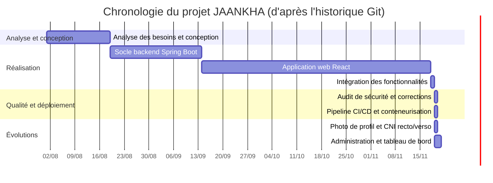

# Partie 2 — Cadres conceptuels et analytiques

# Chapitre 3 : Gestion du projet et choix méthodologique

*(Pilotage du cycle de développement)*

Ce chapitre présente les méthodes de gestion de projet étudiées, justifie la méthode retenue, puis décrit
l'organisation du travail et les outils utilisés pour piloter le projet.

## 3.1 Méthodes de gestion de projet étudiées

### 3.1.1 Le cycle en V

Le cycle en V est une méthode séquentielle : chaque phase (spécification, conception, réalisation) est
terminée avant la suivante, et à chaque phase descendante correspond une phase de vérification. Il convient
aux projets dont les besoins sont stables et connus dès le départ. Son principal inconvénient est la
découverte tardive des problèmes : un défaut de conception n'apparaît souvent qu'en phase de tests.

### 3.1.2 Scrum

Scrum est un cadre agile itératif. Le travail est découpé en itérations courtes (*sprints*, de une à quatre
semaines) à l'issue desquelles un incrément utilisable est livré. Il définit des rôles (*Product Owner*,
*Scrum Master*, équipe de développement), des cérémonies (planification, mêlée quotidienne, revue,
rétrospective) et des artefacts (*backlog* produit, *backlog* de sprint).

### 3.1.3 Kanban

Kanban est une méthode de gestion de flux. Les tâches sont visualisées sur un tableau (*À faire*, *En cours*,
*Terminé*) et le nombre de tâches en cours est limité. Kanban n'impose pas d'itérations fixes : chaque
tâche est livrée dès qu'elle est terminée, ce qui convient aux équipes réduites et aux flux de corrections.

### 3.1.4 PMBOK

Le PMBOK (*Project Management Body of Knowledge*) du PMI est un référentiel de bonnes pratiques couvrant
l'ensemble des domaines de la gestion de projet (périmètre, délais, coûts, qualité, risques,
communication). Il est adapté aux projets d'envergure qui nécessitent un pilotage formel et documenté.

*Tableau 5 : Comparaison des méthodes de gestion de projet*

| Critère | Cycle en V | Scrum | Kanban | PMBOK |
|---|---|---|---|---|
| Approche | Séquentielle | Itérative et incrémentale | Flux continu | Référentiel de processus |
| Gestion du changement | Difficile | Prévue à chaque sprint | Continue | Formalisée |
| Livraison | En fin de projet | À chaque sprint | À chaque tâche terminée | Selon le plan |
| Formalisme | Élevé | Moyen | Faible | Très élevé |
| Adapté à une petite équipe | Moyennement | Oui | Oui | Peu |

## 3.2 Méthode retenue et justification

[À COMPLÉTER : confirmer la méthode réellement suivie par le groupe. La proposition ci-dessous s'appuie sur les
pratiques observables dans le dépôt Git.]

Nous avons retenu une **approche agile itérative, inspirée de Scrum pour le découpage en incréments et de
Kanban pour le suivi du flux de tâches**. Ce choix se justifie par :

- **Des besoins qui se sont précisés en cours de route.** Plusieurs exigences sont apparues au fil des
  essais de l'application : dépôt de la pièce d'identité en deux faces (recto et verso), photo de profil pour
  tous les utilisateurs, filtres par période dans le tableau de bord. Une méthode séquentielle aurait rendu
  ces ajustements coûteux.
- **Une équipe réduite.** Le formalisme de Scrum complet (cérémonies, rôles dédiés) et celui du PMBOK auraient
  été disproportionnés.
- **Des livraisons fréquentes et vérifiées.** Chaque fonctionnalité est développée sur sa propre branche, puis
  fusionnée par une demande de fusion (*pull request*) uniquement lorsque le pipeline d'intégration continue
  est entièrement vert.

Le dépôt témoigne concrètement de cette organisation : chaque fonctionnalité ou correction possède sa
branche (`feat/photo-profil-tous`, `feat/cni-recto-verso`, `feat/admin-menu-actions`,
`feat/dashboard-filtre-periode`, `fix/validation-email`…) et sept demandes de fusion ont été intégrées sur la
branche principale.

## 3.3 Organisation du travail

### 3.3.1 Répartition des tâches

[À COMPLÉTER : membres du groupe et répartition réelle des tâches (analyse, backend, frontend, tests,
déploiement, rédaction du mémoire).]

### 3.3.2 Planification et jalons

L'historique Git permet de reconstituer les principaux jalons du projet.

*Tableau 6 : Jalons du projet issus de l'historique Git*

| Date | Jalon | Contenu |
|---|---|---|
| 19 août 2026 | Initialisation | Création du dépôt et premier socle du backend Spring Boot |
| 14 septembre 2026 | Interface web | Intégration de l'application web React |
| 17 septembre 2026 | Services et contact | Connexion du web au backend, pages Services et Contact |
| 18 novembre 2026 | Intégration | Intégration des fonctionnalités et mise en place des agents de développement assisté |
| 19 novembre 2026 | Qualité et sécurité | Audit de sécurité et corrections, pipeline CI/CD obligatoire avant fusion (PR n° 1 à 3) |
| 19 novembre 2026 | Dossier des utilisateurs | Photo de profil pour tous, pièce d'identité recto et verso (PR n° 4 et 5) |
| 20 novembre 2026 | Administration | Menu d'actions, filtres par période du tableau de bord (PR n° 6 et 7) |

[À COMPLÉTER : planning prévisionnel initial (sprints ou lots) et écarts constatés, si un planning avait été
établi.]

*Figure 1 : Chronologie du projet*

> Note : la phase d'analyse et de conception précède le premier commit ; sa date de début est à confirmer.
> [À COMPLÉTER : date réelle de démarrage du projet.]

### 3.3.3 Flux de travail Git

Le flux de travail suit les principes du *GitHub Flow* :

1. une branche est créée depuis `main` pour chaque fonctionnalité (`feat/…`), correction (`fix/…`),
   tâche technique (`ci/…`, `chore/…`) ou documentation (`docs/…`) ;
2. les commits suivent une convention de nommage (`feat:`, `fix:`, `test:`, `ci:`, `docs:`, `chore:`) ;
3. une demande de fusion est ouverte vers `main` ;
4. le pipeline d'intégration continue s'exécute ; la règle de protection de la branche `main` interdit la
   fusion tant que le contrôle `CI OK` n'est pas vert ;
5. la branche est fusionnée, ce qui déclenche la publication des images Docker.

### 3.3.4 Gestion des risques

| Risque | Impact | Mesure adoptée |
|---|---|---|
| Fuite de données personnelles (pièces d'identité) | Élevé | Stockage privé, accès restreint, tests dédiés |
| Régression lors d'une évolution | Moyen | Tests automatisés et tests de fumée obligatoires avant fusion |
| Fusion de code défectueux | Élevé | Protection de la branche `main` et pipeline CI ; incident réel traité (voir chapitre 7) |
| Perte de données | Élevé | Volumes Docker persistants et procédure de sauvegarde (chapitre 8) |
| Dépassement de délai | Moyen | Livraison par petits incréments fonctionnels |

## 3.4 Outils de gestion de projet

*Tableau 7 : Outils de gestion et de collaboration*

| Outil | Usage |
|---|---|
| Git | Gestion de versions |
| GitHub | Hébergement du dépôt, demandes de fusion, protection de branche |
| GitHub Actions | Intégration et livraison continues |
| Visual Studio Code | Environnement de développement |
| Claude Code (agents `developpeur`, `deployeur`, `redacteur-memoire`) | Assistance au développement, à l'audit de sécurité, au déploiement et à la rédaction, sous la supervision de l'étudiant |
| [À COMPLÉTER : Trello, Notion, Jira…] | [À COMPLÉTER : suivi des tâches et du backlog, si utilisé] |
| [À COMPLÉTER : WhatsApp, Google Meet…] | [À COMPLÉTER : communication de l'équipe] |

## Conclusion du chapitre

Le projet a été piloté de manière itérative, chaque évolution étant livrée par une branche dédiée et
contrôlée par un pipeline automatisé. Cette organisation a permis d'absorber les besoins apparus en cours de
projet tout en préservant la stabilité de la branche principale. Le chapitre suivant présente la conception
de la solution.
