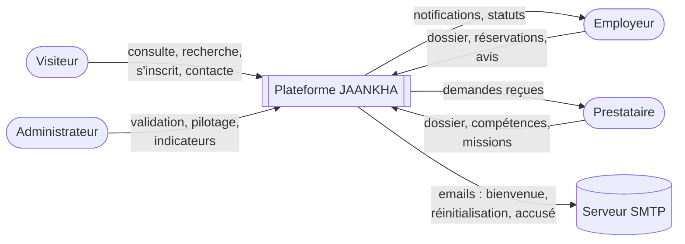
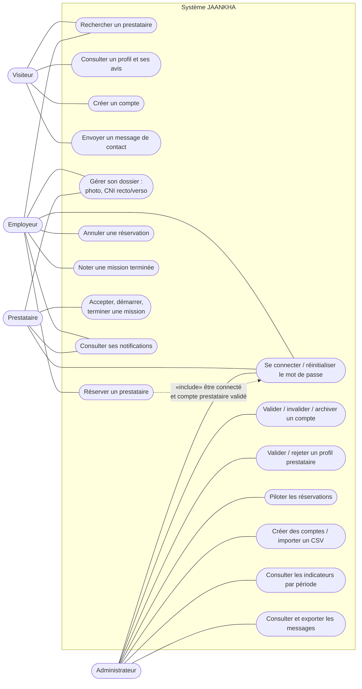
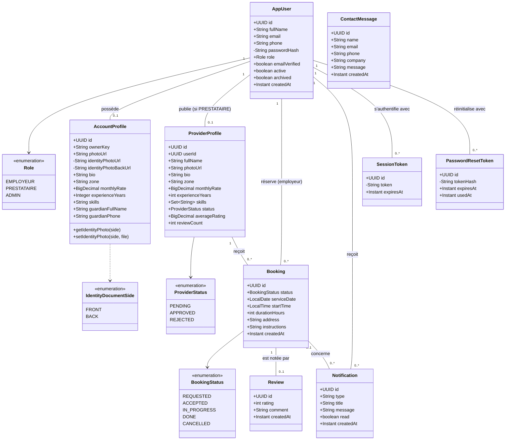
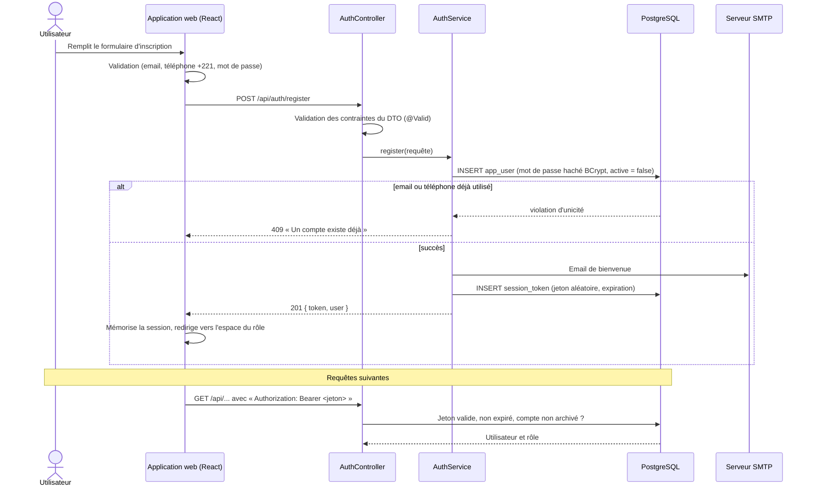
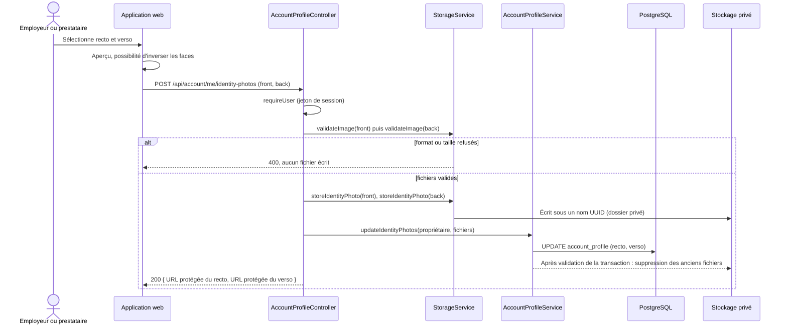
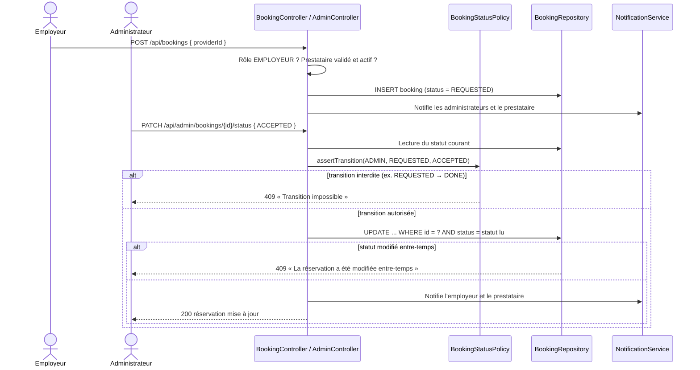
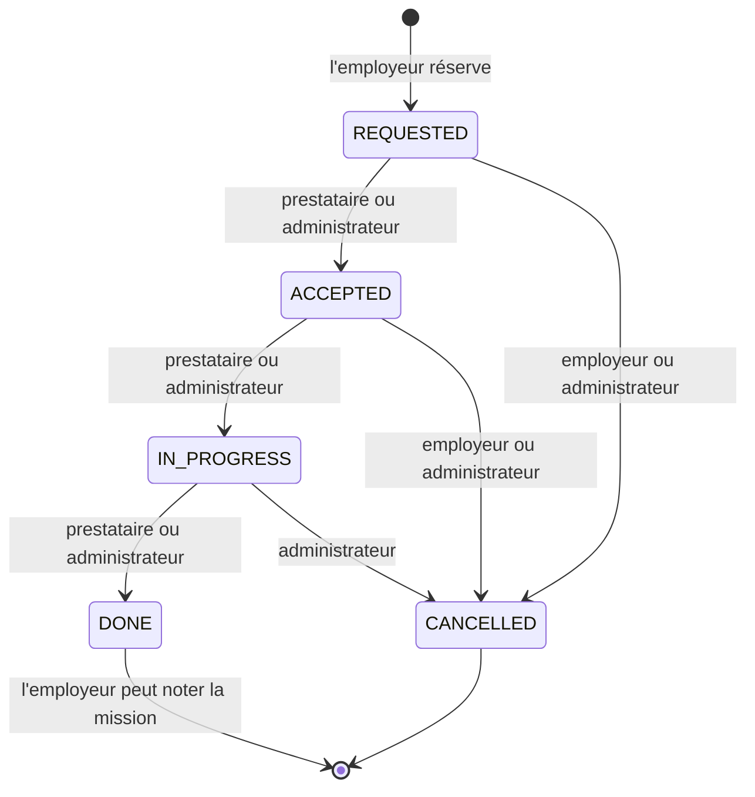
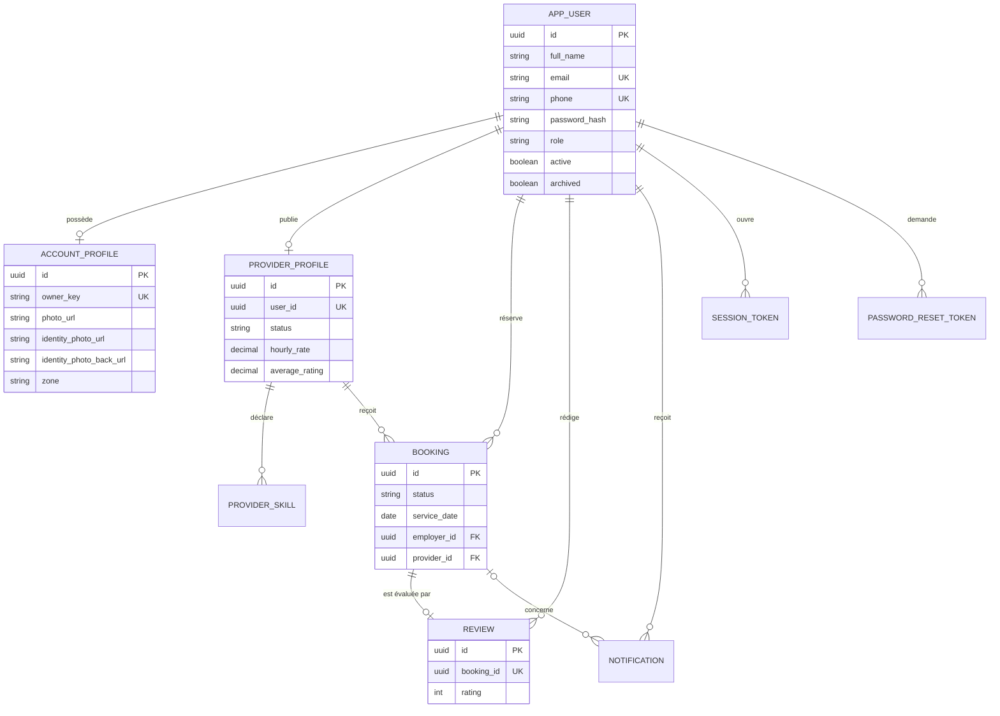
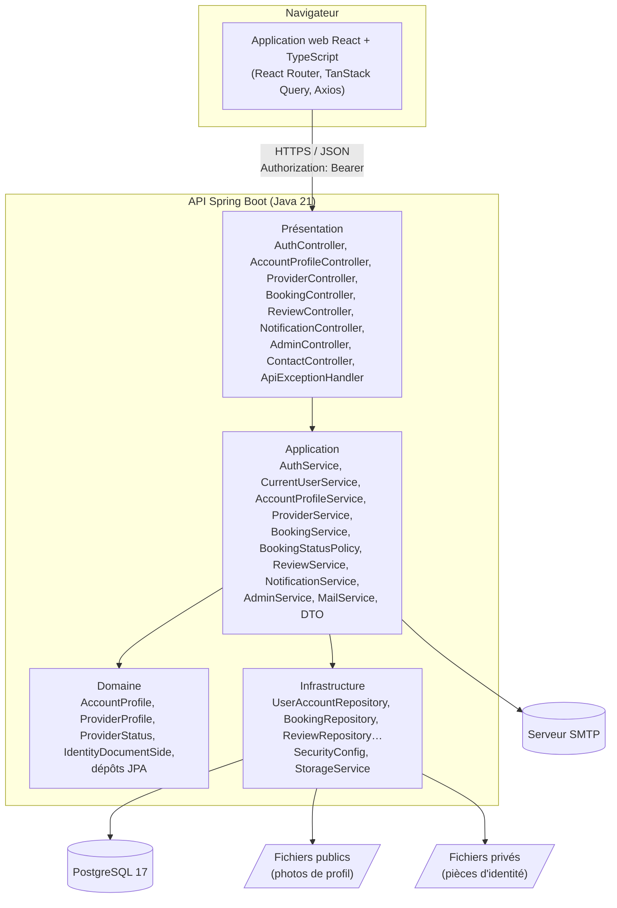

# Chapitre 4 : Conception fonctionnelle et technique du système

*(Phase 2 du cycle de développement : conception)*

Ce chapitre modélise la solution avant sa réalisation. Il présente la modélisation UML, le modèle de
données, l'architecture du système et la justification des choix techniques.

> Les diagrammes sont rédigés en Mermaid ci-dessous et **déjà exportés en images** dans le dossier
> [`figures/`](figures/) (`figure-02-diagramme-contexte.png` à `figure-10-architecture-couches.png`) :
> ce sont ces images qu'il faut insérer dans le document final.

## 4.1 Modélisation UML

### 4.1.1 Diagramme de contexte

Le diagramme de contexte présente le système comme une boîte noire et ses échanges avec les acteurs
externes.

*Figure 2 : Diagramme de contexte*

### 4.1.2 Diagramme de cas d'utilisation

*Figure 3 : Diagramme de cas d'utilisation*

### 4.1.3 Diagramme de classes

Le diagramme de classes représente les principales entités du domaine et leurs relations. Il reflète le
schéma réel : une partie du modèle est gérée par JPA (`AccountProfile`, `ProviderProfile`), l'autre par
requêtes SQL via JdbcTemplate (`AppUser`, `Booking`, `Review`, `Notification`…).

*Figure 4 : Diagramme de classes*

### 4.1.4 Diagrammes de séquence

**Inscription et connexion.** Le serveur ne délivre pas de jeton JWT : il génère un jeton de session opaque,
stocké en base avec une date d'expiration, que le client renvoie dans l'en-tête `Authorization`.

*Figure 5 : Diagramme de séquence — inscription et connexion*

**Dépôt de la pièce d'identité.** Les deux faces peuvent être envoyées ensemble ou séparément. Les deux
fichiers sont validés avant toute écriture, et l'ancien fichier remplacé n'est supprimé qu'après la
validation de la transaction.

*Figure 6 : Diagramme de séquence — dépôt de la pièce d'identité (recto et verso)*

**Réservation et changement de statut.**

*Figure 7 : Diagramme de séquence — réservation et changement de statut*

### 4.1.5 Diagramme d'états d'une réservation

*Figure 8 : Diagramme d'états d'une réservation*

## 4.2 Modélisation de la base de données

### 4.2.1 Modèle conceptuel de données (MCD)

*Figure 9 : Modèle conceptuel de données*

La table `CONTACT_MESSAGE` est indépendante : elle stocke les messages envoyés depuis le formulaire public.

### 4.2.2 Modèle logique de données (MLD)

Le MLD se déduit du MCD : chaque entité devient une table, chaque association « un à plusieurs » est
traduite par une clé étrangère du côté « plusieurs », et la liste des compétences d'un prestataire devient
une table dédiée (`provider_skill`).

*Tableau 8 : Dictionnaire du modèle logique de données*

| Table | Colonnes principales | Remarques |
|---|---|---|
| `app_user` | **id**, full_name, email (unique), phone (unique), password_hash, role, email_verified, active, archived, created_at, updated_at | Comptes des trois rôles |
| `session_token` | **id**, token (unique), *user_id*, expires_at, created_at | Sessions ; durée de vie de 720 heures par défaut |
| `password_reset_token` | **id**, *user_id*, token_hash (unique), expires_at, used_at, created_at | Le jeton est stocké haché (SHA-256), durée de vie de 30 minutes, usage unique |
| `account_profile` | **id**, owner_key (unique, = identifiant de l'utilisateur), photo_url, identity_photo_url (recto), identity_photo_back_url (verso), bio, zone, monthly_rate, experience_years, skills, guardian_full_name, guardian_phone, created_at, updated_at | Dossier de l'utilisateur, géré par JPA |
| `provider_profile` | **id**, owner_key (unique), *user_id* (unique), full_name, photo_url, bio, zone, hourly_rate, experience_years, status, average_rating, review_count, created_at, updated_at | Profil public du prestataire ; `hourly_rate` contient le tarif **mensuel** |
| `provider_skill` | *provider_id*, skill | Compétences d'un prestataire |
| `booking` | **id**, status, service_date, start_time, duration_hours, address, instructions, *employer_id*, *provider_id*, created_at, updated_at | Réservations |
| `review` | **id**, *booking_id* (unique), rating, comment, *employer_id*, *provider_id*, created_at | Un seul avis par réservation |
| `notification` | **id**, type, title, message, *booking_id*, *recipient_id*, read, created_at | Notifications internes |
| `contact_message` | **id**, name, email, phone, company, message, created_at | Messages du formulaire de contact |

Légende : **gras** = clé primaire (UUID), *italique* = clé étrangère logique.

> Les clés étrangères sont aujourd'hui logiques : elles ne sont pas déclarées comme contraintes en base.
> L'intégrité est assurée par l'application ; l'ajout de contraintes `FOREIGN KEY` fait partie des
> perspectives (conclusion générale).

## 4.3 Architecture du système

### 4.3.1 Architecture client-serveur en couches

La solution suit une architecture **client-serveur** : une application monopage (SPA) React s'exécute dans
le navigateur et dialogue en JSON avec une API REST Spring Boot, elle-même connectée à PostgreSQL. Le
serveur est organisé en **quatre couches**, inspirées de l'architecture hexagonale et du modèle MVC :

- **Présentation** (`presentation`) : contrôleurs REST, gestion centralisée des erreurs, contrôle d'accès ;
- **Application** (`application`) : services métier et objets de transfert de données (DTO) ;
- **Domaine** (`domain`) : entités, énumérations et interfaces de dépôt ;
- **Infrastructure** (`infrastructure`) : persistance (JdbcTemplate), sécurité, stockage des fichiers.

*Figure 10 : Architecture logicielle en couches*

### 4.3.2 Contrat d'interface : l'API REST

*Tableau 9 : Points d'accès de l'API REST*

| Méthode et chemin | Rôle requis | Description |
|---|---|---|
| `POST /api/auth/register` | Public | Inscription (employeur ou prestataire) |
| `POST /api/auth/login` | Public | Connexion par email ou téléphone |
| `POST /api/auth/forgot-password` | Public | Demande de lien de réinitialisation |
| `POST /api/auth/reset-password` | Public (jeton) | Choix d'un nouveau mot de passe |
| `GET`, `PUT /api/account/me` | Connecté | Lecture et mise à jour du dossier |
| `POST /api/account/me/photo` | Connecté | Dépôt de la photo de profil |
| `POST /api/account/me/identity-photos` | Connecté | Dépôt du recto et/ou du verso de la pièce d'identité |
| `GET /api/account/me/identity-photo[/back]` | Titulaire | Lecture privée du recto ou du verso |
| `GET /api/providers` | Public | Recherche (zone, compétence, tarif maximal) |
| `GET /api/providers/{id}`, `/{id}/reviews` | Public | Détail d'un prestataire validé et ses avis |
| `GET`, `PUT /api/providers/me` | Prestataire | Profil public du prestataire |
| `POST /api/bookings` | Employeur | Création d'une réservation |
| `GET /api/bookings/me` | Employeur, prestataire | Mes réservations |
| `PATCH /api/bookings/{id}/status` | Employeur, prestataire | Changement de statut selon le cycle de vie |
| `POST /api/reviews` | Employeur | Avis sur une réservation terminée |
| `GET /api/notifications`, `PATCH /{id}/read` | Connecté | Notifications |
| `POST /api/contact/messages` | Public | Message de contact |
| `GET`, `POST /api/admin/users` | Administrateur | Liste et création de comptes |
| `PATCH /api/admin/users/{id}/active`, `/archive` | Administrateur | Validation et archivage d'un compte |
| `GET /api/admin/users/{id}/identity-photo[/back]` | Administrateur | Lecture de la pièce d'identité d'un utilisateur |
| `GET /api/admin/providers`, `PATCH /{id}/status` | Administrateur | Validation des profils prestataires |
| `GET /api/admin/bookings`, `PATCH /{id}/status` | Administrateur | Pilotage des réservations |
| `GET /api/admin/contact-messages[/export]` | Administrateur | Messages de contact et export CSV ou Excel |

## 4.4 Justification des choix techniques et technologiques

*Tableau 10 : Choix technologiques et justifications*

| Domaine | Choix | Justification |
|---|---|---|
| Langage serveur | Java 21 (LTS) | Typage fort, version à support long, écosystème mature |
| Framework serveur | Spring Boot 4.1 | Standard industriel pour les API REST ; validation (Jakarta Validation), sécurité, accès aux données et tests intégrés |
| Accès aux données | JdbcTemplate et Spring Data JPA | SQL explicite et maîtrisé pour les requêtes métier ; JPA pour les profils |
| Base de données | PostgreSQL 17 (H2 en développement et en test) | SGBD relationnel libre et robuste ; H2 en mémoire rend les tests rapides et isolés |
| Sécurité | Jeton de session opaque, BCrypt | Révocation simple (suppression du jeton en base), mots de passe jamais stockés en clair |
| Langage client | TypeScript (mode strict) | Détection des erreurs dès la compilation |
| Framework client | React 19 et Vite 8 | Composants réutilisables, compilation et rechargement rapides |
| Navigation et données | React Router 7, TanStack Query 5, Axios | Routage côté client, mise en cache et rafraîchissement automatique des données |
| Conteneurisation | Docker et Docker Compose | Environnement identique en développement, en CI et en production |
| Serveur web | Nginx (non-root) | Sert l'application compilée et relaie l'API sur la même origine, sans CORS |
| Intégration continue | GitHub Actions | Intégré au dépôt, gratuit pour un dépôt public ou un usage modéré |
| Application mobile | Expo (React Native) | Partage du langage TypeScript avec le web ; **au stade de squelette** dans ce projet |

**Pourquoi un jeton de session plutôt qu'un JWT ?** Un JWT est autonome et ne peut pas être révoqué avant
son expiration sans mécanisme supplémentaire. Le jeton opaque stocké en base permet, au contraire, de
fermer toutes les sessions d'un utilisateur instantanément : c'est ce que fait la réinitialisation du mot de
passe, qui supprime toutes les sessions du compte. Pour une plateforme où un compte peut devoir être
suspendu rapidement, ce choix privilégie le contrôle.

**Pourquoi stocker les pièces d'identité séparément ?** Les photos de profil sont publiques et servies
directement. Les pièces d'identité sont des données sensibles : elles sont stockées dans un dossier distinct,
jamais exposé par le serveur web, et ne sont lisibles qu'à travers des routes qui vérifient l'identité du
demandeur.

## Conclusion du chapitre

La conception a défini les acteurs et leurs cas d'utilisation, les entités et leurs relations, les
interactions clés et le cycle de vie des réservations, ainsi qu'une architecture en couches qui sépare
clairement les responsabilités. Le chapitre suivant estime le coût de la réalisation de cette solution.
