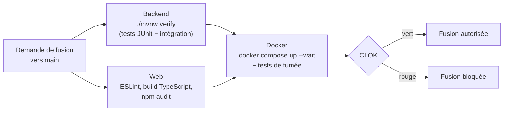

# Chapitre 7 : Tests et validation du système

*(Phase 4 du cycle de développement : tests)*

Ce chapitre présente la stratégie de test, les tests réalisés, la validation des fonctionnalités et les
corrections apportées à la suite des anomalies détectées.

## 7.1 Stratégie de test

Les tests sont organisés en trois niveaux complémentaires :

1. **Tests unitaires** (JUnit 5, Mockito, AssertJ) : chaque règle métier est vérifiée de manière isolée, avec
   des dépendances simulées. Ils sont rapides et précis.
2. **Tests d'intégration** (Spring Boot Test, base H2 en mémoire) : le contexte complet de l'application
   démarre et les requêtes réelles sont exécutées sur une base isolée, sans toucher aux données de
   développement.
3. **Tests de fumée** (*smoke tests*, script Bash) : la pile complète (PostgreSQL, backend, Nginx) est démarrée
   avec Docker Compose et les parcours essentiels sont exécutés comme le ferait un navigateur.

Côté web, la qualité est contrôlée par l'analyse statique (ESLint), la compilation TypeScript en mode strict
et l'audit des dépendances (`npm audit`).

Ces trois niveaux sont exécutés **automatiquement sur chaque demande de fusion** par le pipeline
d'intégration continue ; la fusion est impossible tant qu'ils ne sont pas tous au vert.

*Figure 17 : Pipeline d'intégration continue*



## 7.2 Tests réalisés

### 7.2.1 Tests automatisés du backend

*Tableau 16 : Tests automatisés du backend*

| Classe de test | Nombre | Ce qui est vérifié |
|---|---|---|
| `BookingStatusPolicyTest` | 21 | Transitions autorisées et interdites pour chaque rôle ; statuts inconnus refusés |
| `AccountProfileControllerTest` | 9 | Photo de profil pour les trois rôles ; recto et verso ensemble ou séparément ; refus sans aucune face, avec un fichier invalide ou sans authentification, avant toute écriture |
| `BookingServiceTest` | 6 | Saut de statut refusé ; réservation annulée non réactivable ; mission terminée non annulable ; réservation d'un autre utilisateur introuvable |
| `ProviderServiceTest` | 5 | Profil prestataire réservé au rôle `PRESTATAIRE` ; photo publique issue de l'upload |
| `AccountProfileServiceTest` | 3 | La photo reste après l'enregistrement du dossier ; remplacer le verso conserve le recto et supprime l'ancien fichier |
| `AdminServiceTest` | 3 | Validation refusée sans recto ou sans verso ; acceptée avec les deux |
| `ProviderControllerTest` | 2 | Dépôt de photo refusé sans authentification ou sans le bon rôle, avant toute écriture |
| `UserAccountSchemaInitializerTest` | 2 | Refus de créer un administrateur sans mot de passe |
| `UserAccountRepositoryTest` | 1 | Date d'inscription exposée (test d'intégration sur H2) |
| `BackendApplicationTests` | 1 | Démarrage complet du contexte applicatif |
| **Total** | **53** | Tous au vert sur la branche principale |

Un lot supplémentaire de 14 tests (`EmailValidationTest`) vérifie le refus des adresses email incomplètes
(par exemple `nom@gm`) sur l'inscription, la création de compte par l'administrateur et le formulaire de
contact. [À COMPLÉTER : mettre à jour le total une fois la branche `fix/validation-email` fusionnée.]

Exemple de test unitaire :

```java
@Test
void providerCannotJumpFromRequestedToDone() {
    when(bookingRepository.findStatusOwnedBy(BOOKING_ID, provider.id(), "PRESTATAIRE"))
            .thenReturn(Optional.of("REQUESTED"));

    assertThatThrownBy(() -> bookingService.updateStatus(provider, BOOKING_ID, "DONE"))
            .isInstanceOf(ConflictException.class);
    verify(bookingRepository, never()).updateStatus(any(), anyString(), anyString());
}
```

### 7.2.2 Tests de fumée sur la pile complète

*Tableau 17 : Vérifications des tests de fumée*

| Domaine | Vérifications | Résultat attendu |
|---|---|---|
| Disponibilité | Santé du backend (`/actuator/health`), sonde Nginx (`/healthz`) | 200 |
| Interface | Page d'accueil, route React profonde (`/providers`), présence de l'application | 200 |
| API publique | Recherche de prestataires | 200 |
| Contrôle d'accès | Dossier et administration sans jeton ; administration avec un jeton employeur | 401, 401, 403 |
| Parcours utilisateur | Inscription (écriture en base), lecture du dossier avec le jeton, date d'inscription renvoyée | 201, 200 |
| Photo de profil | Dépôt, puis lecture de l'image par son URL publique ; dépôt sans jeton | 200, 200, 401 |
| Pièce d'identité | Dépôt recto et verso ; la photo de profil n'est pas modifiée ; lecture privée de chaque face ; verso sans jeton ; envoi sans aucune face | 200, inchangée, 200, 401, 400 |
| Confidentialité | Le dossier des pièces d'identité n'est pas accessible publiquement | 404 |
| En-têtes | Présence de `X-Content-Type-Options: nosniff` | Présent |

## 7.3 Validation des fonctionnalités

[À COMPLÉTER : tableau de recette manuelle, une ligne par besoin fonctionnel du chapitre 2 (BF01 à BF17),
avec le scénario joué, le résultat obtenu et la date. Exemple de format ci-dessous.]

| Réf. | Scénario | Résultat attendu | Résultat obtenu |
|---|---|---|---|
| BF05 | Un employeur sélectionne deux images, inverse recto et verso, puis envoie | Les deux faces sont enregistrées dans le bon ordre, la photo de profil n'est pas modifiée | [À COMPLÉTER] |
| BF10 | L'administrateur tente de passer une réservation de *Demandée* à *Terminée* | L'action est grisée ; l'API répond 409 | [À COMPLÉTER] |
| BF16 | L'administrateur sélectionne « Trimestre » | Les quatre indicateurs, le graphique et les activités se limitent au trimestre en cours | [À COMPLÉTER] |

## 7.4 Résultats obtenus et corrections apportées

Les tests, l'audit de sécurité et les essais de l'application ont révélé plusieurs anomalies, toutes
corrigées et couvertes, pour la plupart, par un test qui empêche leur retour.

*Tableau 18 : Anomalies détectées et corrections apportées*

| Anomalie | Origine | Correction | Garde-fou |
|---|---|---|---|
| Dépôt de photo possible sans être connecté | Fichier écrit avant la vérification de l'utilisateur | Authentification et rôle vérifiés avant l'écriture | `ProviderControllerTest` |
| Un prestataire pouvait passer une réservation de *Demandée* à *Terminée* | Aucune règle de transition | Politique de cycle de vie et verrouillage optimiste | `BookingStatusPolicyTest`, `BookingServiceTest` |
| Contrôle du dossier contournable | L'adresse de la photo était fournie par le client | Photo modifiable uniquement par l'upload | `ProviderServiceTest` |
| Mot de passe administrateur par défaut | Valeur écrite dans le code et dans Docker Compose | Suppression ; démarrage refusé sans mot de passe | `UserAccountSchemaInitializerTest` |
| Plus aucune compilation après une fusion | Conflits mal résolus entre deux versions du backend | Restauration de la version testée ; protection de la branche `main` par le pipeline | Pipeline CI obligatoire |
| Le pipeline backend ne pouvait pas s'exécuter | Script `mvnw` non exécutable dans Git | Droits d'exécution corrigés ; fins de ligne LF imposées | Pipeline CI |
| Backend déclaré « en mauvaise santé » | La sonde de santé incluait le serveur SMTP | Sonde limitée à la base et au disque | Tests de fumée |
| 4 vulnérabilités élevées dans les dépendances web | Versions vulnérables | `npm audit fix` | `npm audit` dans le pipeline |
| Photo disparue après actualisation | Conteneur backend obsolète face au nouveau front | Reconstruction du conteneur | `AccountProfileServiceTest` |
| « La photo n'a pas pu être enregistrée » | Volumes créés par l'ancienne image (root) non accessibles en écriture par l'utilisateur non-root | Script de démarrage qui corrige les droits avant de lancer Java sans privilèges | Tests de fumée |
| La pièce d'identité remplaçait la photo de profil | Serveur de développement servant une version périmée d'un module | Redémarrage du serveur de développement | Test de fumée dédié |
| Barre de défilement horizontale sur la gestion des réservations | Largeur minimale fixe du tableau | Largeur adaptative, défilement limité aux petits écrans | Vérification visuelle |
| Texte et icônes superposés sur les cartes du tableau de bord | Cartes plus étroites depuis l'affichage sur une ligne | Mise en page resserrée | Captures automatisées dans Chrome à trois largeurs |
| Compte créé avec l'email `ffffffff@gm` | Le contrôle standard accepte une adresse sans extension | Règle commune stricte au serveur et au client | `EmailValidationTest`, test de fumée |

## Conclusion du chapitre

La combinaison de tests unitaires, de tests d'intégration et de tests de fumée, exécutés automatiquement
avant chaque fusion, a permis de détecter et de corriger des failles de sécurité et des régressions avant
qu'elles n'atteignent la branche principale. Le chapitre suivant décrit le déploiement de la solution.
