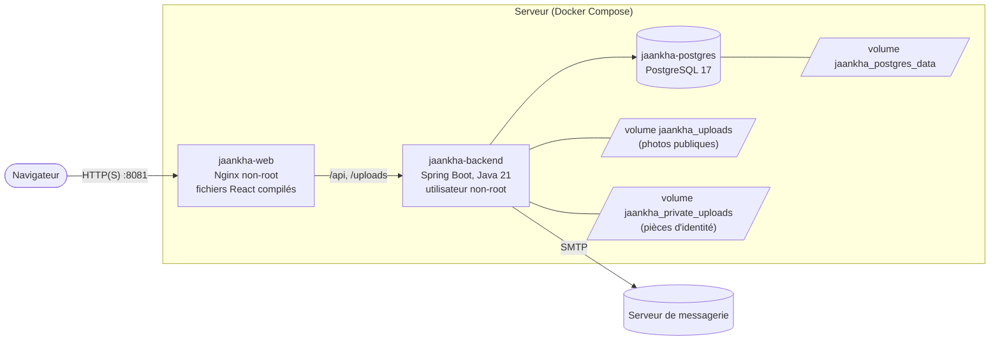

# Chapitre 8 : Déploiement de la solution

*(Phase 5 du cycle de développement : déploiement)*

Ce chapitre présente la préparation de l'environnement d'exécution, l'installation de la base de données et
des dépendances, la mise en production et les procédures de sauvegarde.

## 8.1 Préparation et configuration du serveur

La solution est entièrement **conteneurisée** : chaque composant s'exécute dans un conteneur Docker, et
Docker Compose orchestre l'ensemble. Le serveur cible n'a donc besoin que de Docker ; aucune installation de
Java, de Node.js ou de PostgreSQL n'est nécessaire sur la machine hôte.

*Figure 18 : Architecture de déploiement conteneurisée*



Trois images sont utilisées :

- **Backend** (`backend/Dockerfile`) : construction en deux étapes. Une image Maven compile l'application (les
  dépendances sont mises en cache dans une couche distincte), puis une image d'exécution Java 21 minimale
  l'exécute sous un utilisateur dédié non privilégié. Un script de démarrage corrige les droits des volumes
  avant de lancer Java sans les droits root. Une sonde de santé interroge `/actuator/health`.
- **Web** (`web/Dockerfile`) : construction de l'application React avec Node.js, puis service des fichiers par
  une image Nginx non privilégiée. Nginx relaie `/api` et `/uploads` vers le backend, ajoute des en-têtes de
  sécurité et renvoie `index.html` pour toute route de l'application monopage.
- **Base de données** : image officielle `postgres:17-alpine`, avec une sonde de santé `pg_isready`.

Le démarrage est ordonné : le backend attend que la base soit saine, et le web attend que le backend le soit.

La configuration passe exclusivement par des **variables d'environnement**, décrites dans le fichier
`.env.example` ; le fichier `.env` réel, qui contient les secrets, est exclu de Git.

*Tableau 19 : Variables d'environnement de la solution*

| Variable | Rôle |
|---|---|
| `POSTGRES_DB`, `POSTGRES_USER`, `POSTGRES_PASSWORD` | Base de données |
| `DATABASE_URL`, `DATABASE_USERNAME`, `DATABASE_PASSWORD` | Connexion du backend à la base |
| `BACKEND_PORT`, `WEB_PORT` | Ports exposés (8080 et 8081 par défaut) |
| `CORS_ALLOWED_ORIGIN_PATTERNS` | Origines autorisées à appeler l'API directement |
| `AUTH_TOKEN_TTL_HOURS`, `RESET_TOKEN_TTL_MINUTES` | Durée de vie des sessions (720 h) et des liens de réinitialisation (30 min) |
| `APP_FRONTEND_URL` | Adresse du site, utilisée dans les liens envoyés par email |
| `SMTP_HOST`, `SMTP_PORT`, `SMTP_USERNAME`, `SMTP_PASSWORD`, `SMTP_AUTH`, `SMTP_STARTTLS`, `MAIL_FROM` | Envoi des emails |
| `ADMIN_EMAIL`, `ADMIN_PHONE`, `ADMIN_PASSWORD` | Compte administrateur initial (aucun mot de passe par défaut) |
| `UPLOAD_DIR`, `PRIVATE_UPLOAD_DIR` | Dossiers des fichiers publics et privés |
| `WEB_API_BASE_URL` | Adresse de l'API compilée dans le frontend (`/api` par défaut) |

## 8.2 Installation des dépendances et de la base de données

Les dépendances sont installées **pendant la construction des images** : Maven télécharge les bibliothèques
Java et `npm ci` installe les paquets JavaScript à partir du fichier de verrouillage `package-lock.json`, ce
qui garantit des versions identiques sur toutes les machines.

La base de données est initialisée automatiquement au premier démarrage du backend :

- les tables gérées par JPA (`account_profile`, `provider_profile`, `provider_skill`) sont créées ou mises à
  jour par Hibernate (`ddl-auto=update`) ;
- les autres tables (`app_user`, `session_token`, `booking`, `review`, `notification`…) sont créées par le
  composant `UserAccountSchemaInitializer`, de façon idempotente (`create table if not exists`) ;
- le compte administrateur initial est créé à partir des variables `ADMIN_*` s'il n'existe pas encore.

Les étapes d'installation sur un serveur sont donc :

```bash
git clone <url-du-depot> jaankha && cd jaankha
cp .env.example .env          # puis renseigner les mots de passe et le serveur SMTP
docker compose up --build -d --wait
bash .github/scripts/smoke-test.sh http://localhost:8081 http://localhost:8080
```

[À COMPLÉTER : captures de la commande `docker compose up` et des conteneurs « healthy ».]

## 8.3 Mise en production de l'application

La mise en production est automatisée par le workflow GitHub Actions `deploy.yml` :

1. **à chaque fusion sur `main`**, le pipeline d'intégration continue complet est relancé sur le commit
   fusionné ;
2. s'il réussit, les images du backend et du web sont construites et publiées sur le registre de GitHub
   (`ghcr.io/<propriétaire>/jaakha-backend` et `ghcr.io/<propriétaire>/jaakha-web`), étiquetées avec
   l'identifiant du commit et le nom de l'environnement ;
3. le déploiement est déclenché chez l'hébergeur par l'appel d'un *deploy hook*, dont l'adresse est stockée
   comme secret de l'environnement GitHub (`staging` automatiquement, `production` sur lancement manuel,
   avec validation possible).

[À COMPLÉTER : hébergeur retenu (Render, Railway, VPS…) et sa configuration ; adresse publique de
l'application ; captures du déploiement.]

*Figure 19 : Exécution du pipeline sur GitHub Actions* — [À COMPLÉTER : capture de l'onglet *Actions* montrant
les contrôles « Backend », « Web », « Docker » et « CI OK » au vert.]

**Points de vigilance pour la production :**

- servir le site en HTTPS (certificat fourni par l'hébergeur ou par un proxy tel que Caddy ou Traefik) ;
- restreindre `CORS_ALLOWED_ORIGIN_PATTERNS` au seul domaine de production ;
- utiliser des mots de passe forts et uniques pour la base et le compte administrateur ;
- monter les volumes de fichiers sur un stockage persistant ; le dossier des pièces d'identité ne doit
  jamais être exposé publiquement.

## 8.4 Procédures de sauvegarde

Les données à protéger sont la base PostgreSQL et les deux volumes de fichiers. La procédure suivante est
recommandée.

*Tableau 20 : Procédure de sauvegarde et de restauration*

| Élément | Sauvegarde | Restauration | Fréquence conseillée |
|---|---|---|---|
| Base de données | `docker exec jaankha-postgres pg_dump -U <utilisateur> -d <base> > sauvegarde.sql` | `docker exec -i jaankha-postgres psql -U <utilisateur> -d <base> < sauvegarde.sql` | Quotidienne |
| Photos publiques | `docker run --rm -v jaankha_uploads:/data -v "$PWD":/backup alpine tar czf /backup/uploads.tgz -C /data .` | Commande inverse (`tar xzf`) dans le volume | Quotidienne |
| Pièces d'identité | Même commande sur le volume `jaankha_private_uploads`, archive **chiffrée** | Commande inverse | Quotidienne |

Les sauvegardes doivent être conservées hors du serveur et testées régulièrement par une restauration
d'essai. Les archives contenant des pièces d'identité sont des données personnelles : elles doivent être
chiffrées et leur accès restreint. [À COMPLÉTER : outil d'automatisation retenu (tâche planifiée `cron`,
service de sauvegarde de l'hébergeur) et durée de conservation.]

## Conclusion du chapitre

Grâce à la conteneurisation et à l'automatisation du pipeline, la solution s'installe avec une seule
commande, et chaque mise en production est précédée d'une vérification complète. Il reste à choisir
l'hébergeur de production et à automatiser les sauvegardes.
